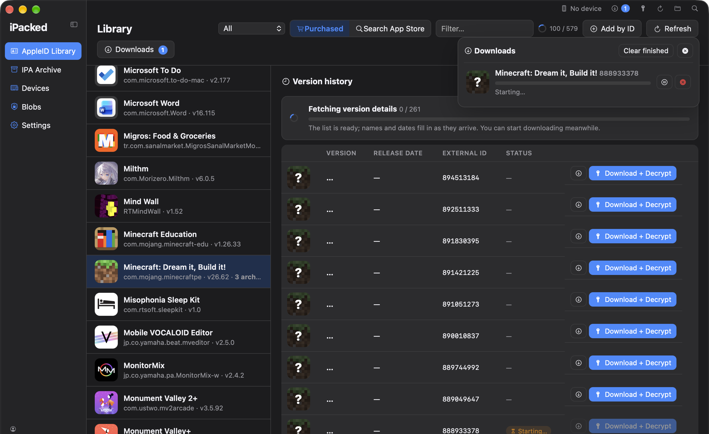
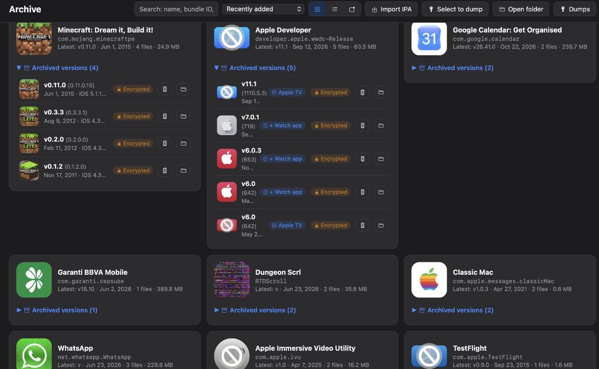
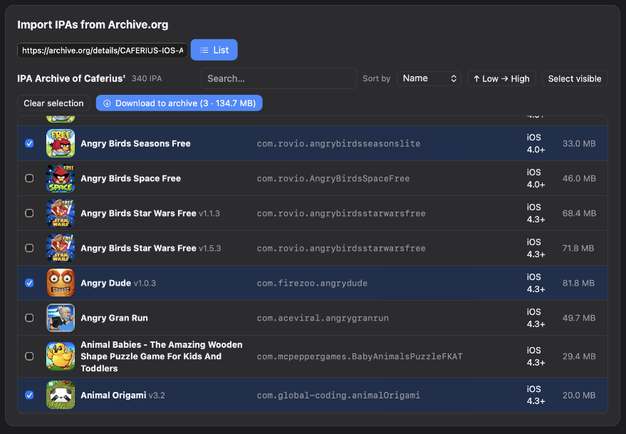
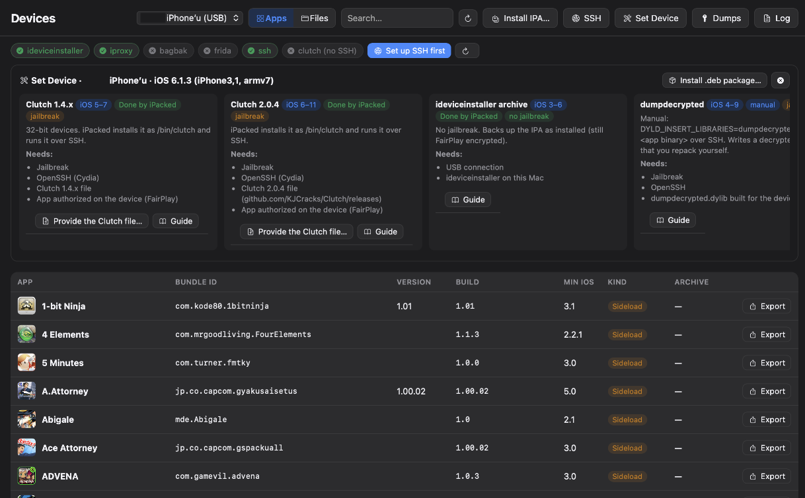
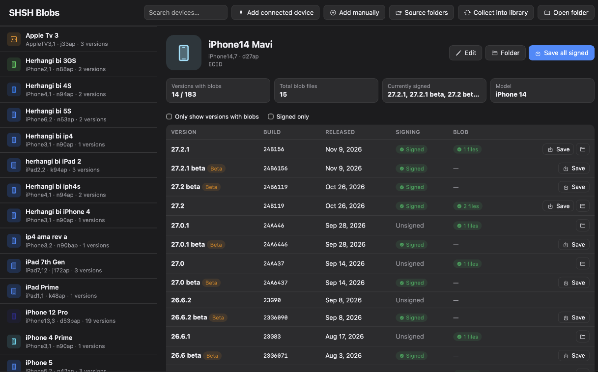

<div align="center">

<!-- App icon (generated from src-tauri/icons/icon.png) -->


# iPacked

**English · [Türkçe](README.tr.md)**

**Your entire App Store history — every version, every platform — archived on your Mac.**

Download old versions of the apps you own, keep them forever, install them on any iPhone or iPad, save SHSH blobs and dump decrypted IPAs. All in one native macOS app.




</div>

---

## What is iPacked?

Apps change. Features get removed, old devices stop being supported, apps vanish from the App Store. **iPacked lets you keep the versions you love.**

Sign in with your Apple ID, and iPacked shows every app you've ever bought or downloaded, on every Apple platform. Pick any version Apple still serves, from the first release to today, and download the original IPA straight from Apple. Your archive stays organized on your Mac, ready to install on any device whenever you need it.

> [!TIP]
> ### 🕰️ An app was removed from the App Store, but it's still in your Apple ID purchases, and you can't get its old versions anymore?
> **iPacked might be exactly what you're looking for.** It lists every app in your purchase history, including ones that are no longer on the App Store, and lets you pick and download any version Apple still serves for your account, not just the latest one. Bring back the version you remember, archive it, and install it on your device.


> Built on the shoulders of three great open-source projects: **[Impactor](#credits)**, **[ipatool](#credits)** and **[blobsaver](#credits)**. See [Credits](#credits).

---

## Features

### 📚 Library: every purchase, every version
- **All** store: every purchase on **iPhone & iPad, Mac, Apple TV, Apple Watch and Apple Vision** in one searchable list
- Browse the **full version history** of any app and download any build still on Apple's servers
- App Store search that returns the same results and order as the real App Store
- Universal apps show a **Platforms** row, so you can switch platform and get that platform's builds with one click
- Developer pages, supported devices, minimum OS, "What's New", add apps by ID or link


### 🗄️ Archive: your personal IPA museum
- Every IPA is neatly named (e.g. `Minecraft v0.3.3 (0.3.3.1) (9470435)`) and indexed
- Real platform icons: Apple TV, Apple Watch, Apple Vision, iMessage apps and stickers, all in their native shapes
- Built-in **Archive.org** browser to find versions Apple no longer serves
- Right-click actions: open, show in Finder, get license, refresh icon, install on device







### 📱 Devices: install anywhere, old or new devices!
- Plug in an iPhone / iPad and it's detected instantly
- **Install IPAs** on modern devices, plus **legacy iOS support** (down to iOS 5 over SSLv3/TLS 1.0, with automatic libimobiledevice fallback)
- **Dump decrypted IPAs** with a guided method picker: device archive, Clutch, dumpdecrypted, flexdecrypt, bfdecrypt, CrackerXI+, frida-ios-dump, bagbak + Frida, TrollDecrypt. Methods that don't fit your iOS version are greyed out automatically
- Step-by-step guides for every method

> [!WARNING]
> **Dump methods: testing is still in progress.** So far only **Clutch** has been tested end to end. Frida-based methods (frida-ios-dump, bagbak + Frida), TrollDecrypt, flexdecrypt, bfdecrypt, CrackerXI+ and dumpdecrypted are included but **not fully tested yet**, so they may not work on every device or iOS version.
> It's best to **install these tools yourself** from their official sources (on the device and on your Mac) and follow each tool's own instructions. iPacked's guides point you there. Reports and pull requests are very welcome!
> Installing the applications on newer devices has not yet been tested.




### 🔐 Blobs: save SHSH2 blobs (blobsaver inside)
- Save blobs for signed firmwares, **including current betas** (via AppleDB)
- **Read ApNonce + generator** directly from the connected device
- Keep blobs for all your devices in one place



### ✨ Feels like a Mac app
- Native look with SF Symbols, light/dark icon, System / Light / Dark themes
- Keyboard first: **⌘1 to ⌘5** switch sections, **⌘F** search, **⌘R** refresh, **Esc** closes anything
- Lightweight: the App Store helper quits when idle, and long lists are paged
- **English and Türkçe** built in. Fix or add translations right in the app (Settings → Language → Edit texts)

---

## Download

Grab the latest `.dmg` from **[Releases](../../releases)** (e.g. `iPacked_1.2.1_universal.dmg`, runs natively on Apple Silicon and Intel).

| Platform | Status |
|---|---|
| macOS 12 Monterey or later (Apple Silicon & Intel, universal) | ✅ Supported |
| macOS 11 Big Sur or earlier | ❌ Not supported (ipatool needs macOS 12+) |
| Linux | 🛠️ Planned |
| Windows | 💭 Maybe later |

> iPacked isn't notarized yet. On first launch, right-click the app and choose **Open**.

---

## 🚀 Upcoming: iPacked Lite (iParchive) for older macOS

**[Upcoming!]** A version of iPacked for **older macOS releases**, without ipatool.

**iParchive / iPacked Lite** does the same job without the App Store sign-in: list and manage **your own IPA collection** and **decrypt your apps more easily**. It even includes a **Web Archive downloader** and an **IPA installer**!

Stay tuned. ⭐ Star the repo to get notified when it ships.

---

## Credits

iPacked wouldn't exist without these projects. Huge thanks to their authors:

| Project | What iPacked uses it for | License |
|---|---|---|
| **[Impactor](https://github.com/claration/Impactor)** by Samara M | Its Rust crates power device communication, app signing and installation | MIT |
| **[ipatool](https://github.com/majd/ipatool)** by Majd Alfhaily | Embedded as a sidecar for App Store sign-in, purchase lists, version history and IPA downloads | MIT |
| **[blobsaver](https://github.com/airsquared/blobsaver)** by airsquared | The SHSH blob saving and ApNonce reading logic is ported from blobsaver | GPL-3.0 |
| **[idevice](https://github.com/jkcoxson/idevice)** by jkcoxson | Vendored in `legacy-helper` for legacy iOS device support | MIT |
| [tsschecker](https://github.com/1Conan/tsschecker) | Blob requests to Apple's TSS server | LGPL-3.0 |
| [AppleDB](https://appledb.dev) | Firmware and beta metadata | — |

---

## Building from source

Requirements: macOS 12+, Rust, Node.js, Go (for ipatool).

```bash
# Repo layout expected by the build:
#   iPacked/            ← this repo
#   impactor-main/      ← Impactor, cloned next to it
#   ipatool-main/       ← ipatool, cloned next to it

npm install
npx tauri dev       # development
npx tauri build     # .app (use scripts/make-dmg.sh for the release DMG)
```

Build the helpers for both architectures (macOS 12 target), then merge them into universal binaries:
```bash
export MACOSX_DEPLOYMENT_TARGET=12.0 CGO_ENABLED=1
B=../iPacked/src-tauri/binaries
cd ../ipatool-main
GOARCH=arm64 CC="clang -arch arm64 -mmacosx-version-min=12.0" go build -o $B/ipatool-aarch64-apple-darwin .
GOARCH=amd64 CC="clang -arch x86_64 -mmacosx-version-min=12.0" go build -o $B/ipatool-x86_64-apple-darwin .
lipo -create $B/ipatool-aarch64-apple-darwin $B/ipatool-x86_64-apple-darwin -output $B/ipatool-universal-apple-darwin
cd ../iPacked/legacy-helper
cargo build --release --target aarch64-apple-darwin && cargo build --release --target x86_64-apple-darwin
lipo -create target/aarch64-apple-darwin/release/ipacked-legacy target/x86_64-apple-darwin/release/ipacked-legacy -output ../src-tauri/binaries/ipacked-legacy-universal-apple-darwin
cd .. && clang -O2 -mmacosx-version-min=12.0 -arch x86_64 -arch arm64 -o src-tauri/binaries/fpdecrypt fairplay-helper/fpdecrypt.c
```

Rust needs both targets: `rustup target add aarch64-apple-darwin x86_64-apple-darwin`.

Build the universal app and DMG (`iPacked_<version>_universal.dmg`):
```bash
scripts/make-dmg.sh
```

Generate the SF Symbol icons (not included in the repo because of Apple's license):
```bash
swift scripts/render-sf-symbols.swift ui/sf
```

### Optional tools for device features
```bash
brew install ideviceinstaller libimobiledevice libirecovery   # legacy iOS + ApNonce
npm install -g bagbak                                          # bagbak + Frida dumps (untested)
```

### Where data lives
`~/Documents/iPacked/`: `<bundleId>/<version>_<external-id>.ipa`, `index.json`, `icons/`, `cache.json`, `.impactor/` (signing account and certificates, **keep private**).

---

## License

iPacked is free software, licensed under the **[GNU General Public License v3.0](LICENSE)** (GPL-3.0-only).

Copyright (C) 2026 Xmior

You can use, study, share and modify it. If you distribute a modified version, it must stay open source under the same license.

Why GPL-3.0? iPacked's SHSH blob saving and ApNonce reading are ported from [blobsaver](https://github.com/airsquared/blobsaver), which is GPL-3.0. The other projects it uses are MIT (Impactor, ipatool, idevice) or LGPL-3.0 (tsschecker), all compatible with GPL-3.0. Their own license notices are kept with their code.

---

## Disclaimer

iPacked is intended for **personal archiving of apps you have legitimately acquired** with your own Apple ID, and for educational and research purposes. It does not bypass purchases: Apple only issues licenses for apps on your own account. Do not use iPacked to distribute copyrighted apps. iPacked is not affiliated with or endorsed by Apple Inc. App Store, iPhone, iPad, Mac, Apple TV, Apple Watch and Apple Vision are trademarks of Apple Inc.
