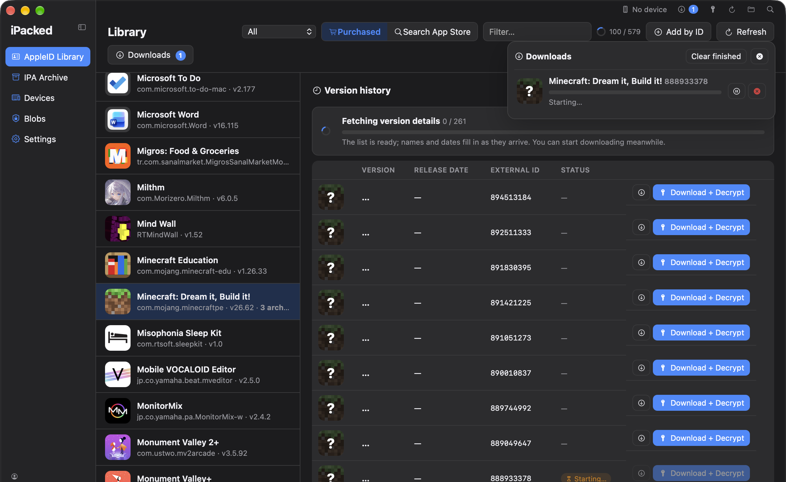
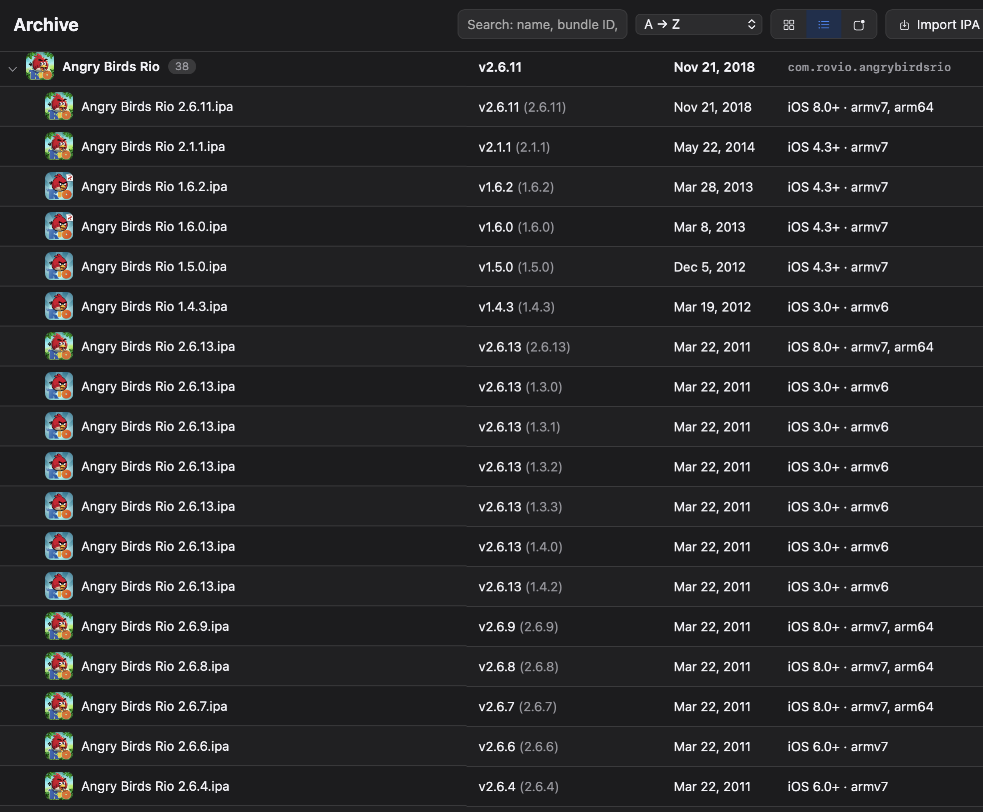
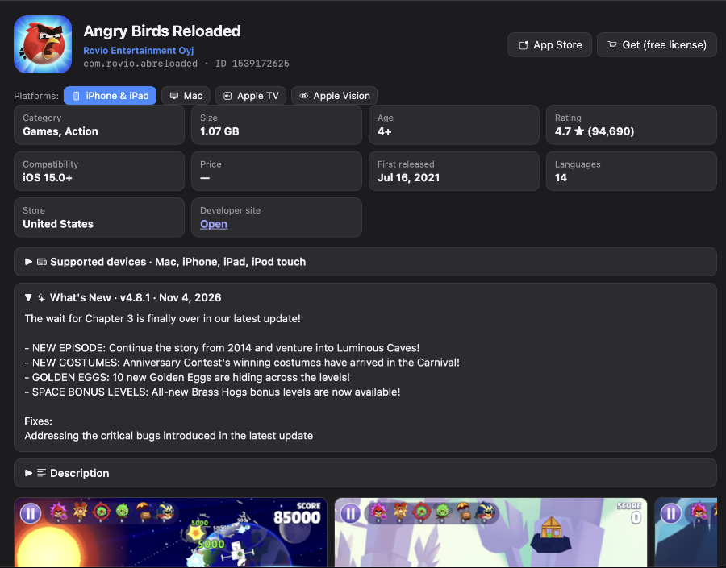
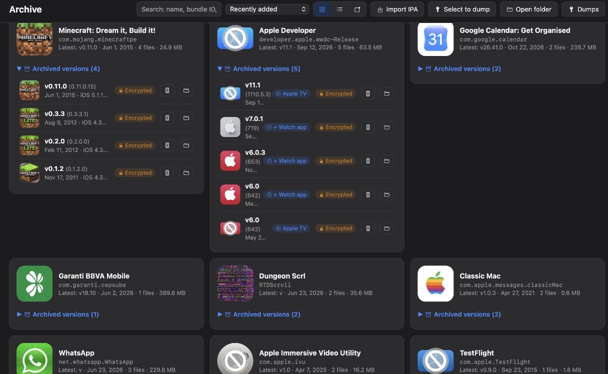
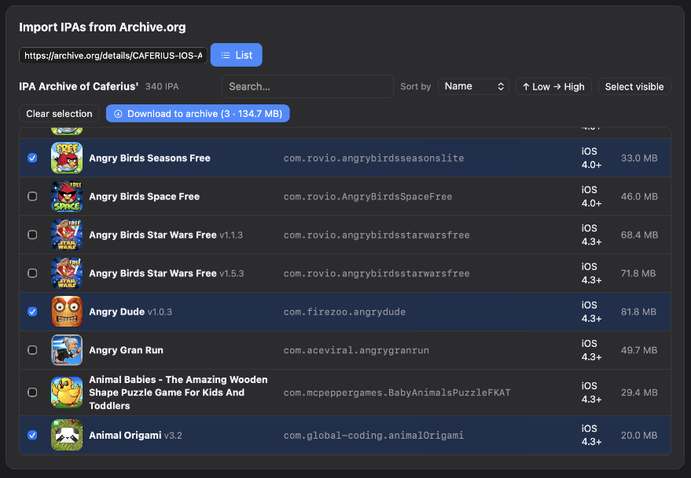
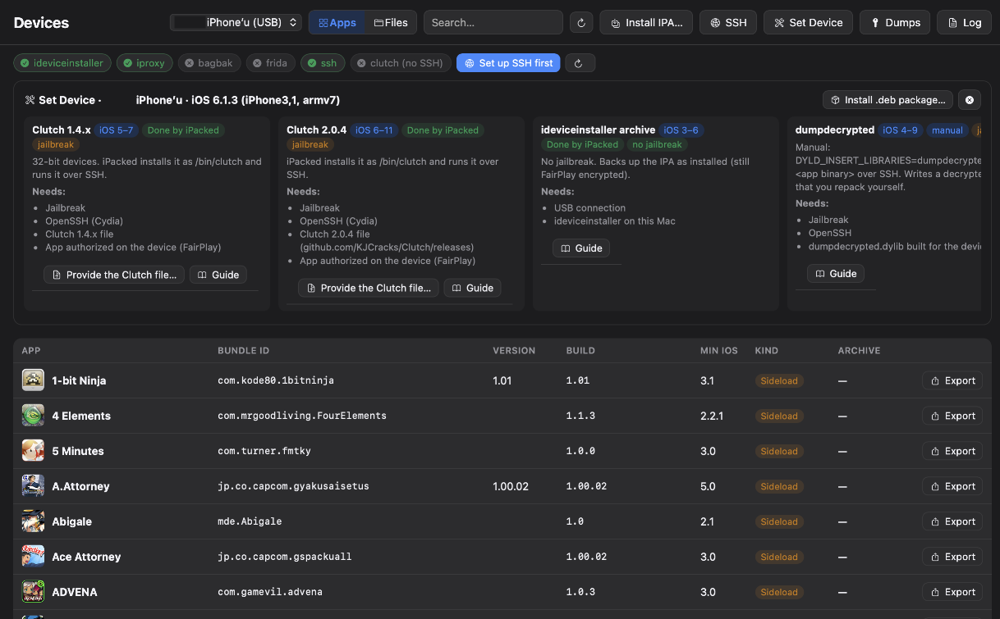
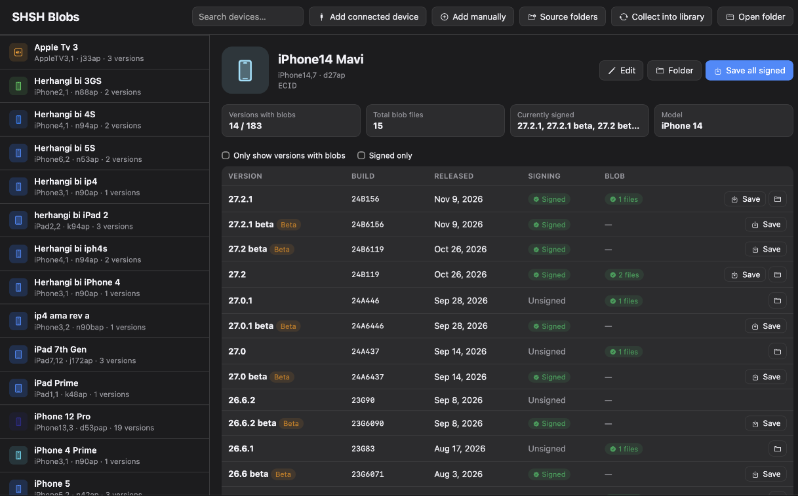

<div align="center">


# iPacked

**[English](README.md) · Türkçe**

**Tüm App Store geçmişin, her sürüm, her platform, Mac'inde arşivli.**

Sahip olduğun uygulamaların eski sürümlerini indir, sonsuza kadar sakla, herhangi bir iPhone ya da iPad'e kur (iOS 5'e kadar), SHSH bloblarını kaydet ve şifresi çözülmüş IPA dump'ları al. Hepsi tek bir yerel macOS uygulamasında.




</div>

---

## iPacked nedir?

Uygulamalar değişir. Özellikler kaldırılır, eski cihazların desteği kesilir, uygulamalar App Store'dan kaybolur. **iPacked sevdiğin sürümleri saklamanı sağlar.**

Apple ID'nle giriş yap; iPacked, şimdiye kadar satın aldığın ya da indirdiğin her uygulamayı tüm Apple platformlarında gösterir. Apple'ın hâlâ sunduğu herhangi bir sürümü, ilk yayından bugüne kadar seç ve orijinal IPA'yı doğrudan Apple'dan indir. Arşivin Mac'inde düzenli durur, ihtiyaç duyduğunda herhangi bir cihaza kurmaya hazırdır.

> [!TIP]
> ### 🕰️ Bir uygulama App Store'dan kaldırıldı, Apple ID kitaplığında hâlâ duruyor ama eski sürümlerini indiremiyor musun?
> **iPacked tam aradığın şey olabilir.** Satın alma geçmişindeki her uygulamayı, artık App Store'da olmayanlar dahil listeler ve sadece en sonuncusunu değil, Apple'ın hesabın için hâlâ sunduğu herhangi bir sürümü seçip indirmeni sağlar. Hatırladığın sürümü geri getir, arşivle ve cihazına kur.



> Üç harika açık kaynak projenin omuzlarında duruyor: **[Impactor](#teşekkürler)**, **[ipatool](#teşekkürler)** ve **[blobsaver](#teşekkürler)**. Bkz. [Teşekkürler](#teşekkürler).

---

## Özellikler

### 📚 Kitaplık: her satın alım, her sürüm
- **Tümü** mağazası: **iPhone ve iPad, Mac, Apple TV, Apple Watch ve Apple Vision**'daki tüm satın alımların aranabilir tek bir listede
- Herhangi bir uygulamanın **tüm sürüm geçmişine** göz at ve Apple'ın sunucularında hâlâ duran her build'i indir
- Gerçek App Store ile aynı sonuçları, aynı sırayla veren App Store araması
- Universal uygulamalarda **Platformlar** satırı: tek tıkla platform değiştir ve o platformun build'lerini al
- Geliştirici sayfaları, desteklenen cihazlar, en düşük OS, "Yenilikler", ID ya da linkle uygulama ekleme



### 🗄️ Arşiv: kişisel IPA müzen
- Her IPA düzenli adlandırılır (örn. `Minecraft v0.3.3 (0.3.3.1) (9470435)`) ve dizinlenir
- Gerçek platform ikonları: Apple TV, Apple Watch, Apple Vision, iMessage uygulamaları ve çıkartmaları, hepsi kendi şekilleriyle
- Apple'ın artık sunmadığı sürümleri bulmak için yerleşik **Archive.org** tarayıcısı
- Sağ tık işlemleri: aç, Finder'da göster, lisans al, ikonu yenile, cihaza kur





### 📱 Cihazlar: her yere kur, eski iPhone'lara bile
- iPhone / iPad'i tak, anında algılanır
- Modern cihazlara **IPA kur**, üstüne **eski iOS desteği** (SSLv3/TLS 1.0 ile iOS 5'e kadar, gerekirse otomatik olarak libimobiledevice'a geçer)
- Rehberli yöntem seçiciyle **şifresi çözülmüş IPA dump'ı al**: cihaz arşivi, Clutch, dumpdecrypted, flexdecrypt, bfdecrypt, CrackerXI+, frida-ios-dump, bagbak + Frida, TrollDecrypt. iOS sürümüne uymayan yöntemler otomatik olarak gri görünür
- Her yöntem için adım adım rehber

> [!WARNING]
> **Dump yöntemleri: testler hâlâ sürüyor.** Şimdiye kadar baştan sona sadece **Clutch** test edildi. Frida tabanlı yöntemler (frida-ios-dump, bagbak + Frida), TrollDecrypt, flexdecrypt, bfdecrypt, CrackerXI+ ve dumpdecrypted uygulamada var ama **henüz tam test edilmedi**, her cihazda ya da her iOS sürümünde çalışmayabilir.
> Bu araçları resmi kaynaklarından (cihaza ve Mac'ine) **kendin kurman** ve her aracın kendi talimatlarını izlemen en iyisi. iPacked'in rehberleri seni oraya yönlendirir. Hata bildirimlerine ve pull request'lere açığız!



### 🔐 Bloblar: SHSH2 blob kaydetme (içinde blobsaver)
- İmzalı firmware'ler için blob kaydet, **güncel betalar dahil** (AppleDB üzerinden)
- **ApNonce + generator**'ı doğrudan bağlı cihazdan oku
- Tüm cihazlarının bloblarını tek yerde tut



### ✨ Gerçek bir Mac uygulaması gibi
- SF Symbols ile yerel görünüm, açık/koyu ikon, Sistem / Açık / Koyu temalar
- Klavye dostu: **⌘1–⌘5** bölümler arasında geçiş, **⌘F** arama, **⌘R** yenileme, **Esc** her şeyi kapatır
- Hafif: App Store yardımcısı boştayken kapanır, uzun listeler sayfalara bölünür
- **English ve Türkçe** yerleşik. Çevirileri doğrudan uygulamadan düzelt ya da yeni dil ekle (Ayarlar → Dil → Metinleri düzenle)

---

## İndir

En son `.dmg` dosyasını **[Releases](../../releases)** sayfasından al (örn. `iPacked_1.2.1_universal.dmg`, Apple Silicon ve Intel'de yerel olarak çalışır).

| Platform | Durum |
|---|---|
| macOS 12 Monterey ve sonrası (Apple Silicon ve Intel, universal) | ✅ Destekleniyor |
| macOS 11 Big Sur ve öncesi | ❌ Desteklenmiyor (ipatool macOS 12+ istiyor) |
| Linux | 🛠️ Planlanıyor |
| Windows | 💭 Belki ileride |

> iPacked henüz notarize edilmedi. İlk açılışta uygulamaya sağ tıkla ve **Aç**'ı seç.

---

## 🚀 Yakında: eski macOS'lar için iPacked Lite (iParchive)

**[Yakında!]** iPacked'in **eski macOS sürümleri** için, ipatool'suz bir versiyonu.

**iParchive / iPacked Lite** aynı işi App Store girişi olmadan yapıyor: **kendi IPA koleksiyonunu** listele, yönet ve **uygulamalarının şifresini daha kolay çöz**. İçinde bir **Web Archive indiricisi** ve bir **IPA kurucusu** bile var!

Takipte kal. ⭐ Çıktığında haberdar olmak için repoya yıldız ver.

---

## Teşekkürler

iPacked bu projeler olmadan var olamazdı. Yazarlarına çok teşekkürler:

| Proje | iPacked'te ne için kullanılıyor | Lisans |
|---|---|---|
| **[Impactor](https://github.com/claration/Impactor)** (Samara M) | Rust crate'leri cihaz iletişimini, uygulama imzalamayı ve kurulumu sağlıyor | MIT |
| **[ipatool](https://github.com/majd/ipatool)** (Majd Alfhaily) | App Store girişi, satın alma listeleri, sürüm geçmişi ve IPA indirme için gömülü yardımcı program | MIT |
| **[blobsaver](https://github.com/airsquared/blobsaver)** (airsquared) | SHSH blob kaydetme ve ApNonce okuma mantığı blobsaver'dan aktarıldı | GPL-3.0 |
| **[idevice](https://github.com/jkcoxson/idevice)** (jkcoxson) | Eski iOS cihaz desteği için `legacy-helper` içinde | MIT |
| [tsschecker](https://github.com/1Conan/tsschecker) | Apple'ın TSS sunucusuna blob istekleri | LGPL-3.0 |
| [AppleDB](https://appledb.dev) | Firmware ve beta bilgileri | — |

---

## Kaynaktan derleme

Gereksinimler: macOS 12+, Rust, Node.js, Go (ipatool için).

```bash
# Derlemenin beklediği klasör yapısı:
#   iPacked/            ← bu repo
#   impactor-main/      ← Impactor, yanına klonlanmış
#   ipatool-main/       ← ipatool, yanına klonlanmış

npm install
npx tauri dev       # geliştirme
npx tauri build     # .app (release DMG'si için scripts/make-dmg.sh kullan)
```

Yardımcı programları iki mimari için (macOS 12 hedefiyle) derle, sonra universal olarak birleştir:
```bash
export MACOSX_DEPLOYMENT_TARGET=12.0 CGO_ENABLED=1
B=../iPacked/src-tauri/binaries
cd ../ipatool-main
GOARCH=arm64 CC="clang -arch arm64 -mmacosx-version-min=12.0" go build -o $B/ipatool-aarch64-apple-darwin .
GOARCH=amd64 CC="clang -arch x86_64 -mmacosx-version-min=12.0" go build -o $B/ipatool-x86_64-apple-darwin .
lipo -create $B/ipatool-aarch64-apple-darwin $B/ipatool-x86_64-apple-darwin -output $B/ipatool-universal-apple-darwin
cd ../iPacked/legacy-helper
cargo build --release --target aarch64-apple-darwin && cargo build --release --target x86_64-apple-darwin
lipo -create target/aarch64-apple-darwin/release/ipacked-legacy target/x86_64-apple-darwin/release/ipacked-legacy -output ../src-tauri/binaries/ipacked-legacy-universal-apple-darwin
cd .. && clang -O2 -mmacosx-version-min=12.0 -arch x86_64 -arch arm64 -o src-tauri/binaries/fpdecrypt fairplay-helper/fpdecrypt.c
```

Rust'ta iki hedef de kurulu olmalı: `rustup target add aarch64-apple-darwin x86_64-apple-darwin`.

Universal uygulamayı ve DMG'yi derle (`iPacked_<sürüm>_universal.dmg`):
```bash
scripts/make-dmg.sh
```

SF Symbol ikonlarını üret (Apple'ın lisansı nedeniyle repoda yok):
```bash
swift scripts/render-sf-symbols.swift ui/sf
```

### Cihaz özellikleri için isteğe bağlı araçlar
```bash
brew install ideviceinstaller libimobiledevice libirecovery   # eski iOS + ApNonce
npm install -g bagbak                                          # bagbak + Frida dump'ları (test edilmedi)
```

### Veriler nerede durur
`~/Documents/iPacked/`: `<bundleId>/<sürüm>_<harici-id>.ipa`, `index.json`, `icons/`, `cache.json`, `.impactor/` (imzalama hesabı ve sertifikalar, **gizli tut**).

---

## Lisans

iPacked özgür bir yazılımdır ve **[GNU Genel Kamu Lisansı v3.0](LICENSE)** (GPL-3.0-only) ile lisanslanmıştır.

Copyright (C) 2026 Xmior

Kullanabilir, inceleyebilir, paylaşabilir ve değiştirebilirsin. Değiştirilmiş bir sürümü dağıtırsan, o da aynı lisansla açık kaynak kalmak zorundadır.

Neden GPL-3.0? iPacked'in SHSH blob kaydetme ve ApNonce okuma kodu GPL-3.0 lisanslı [blobsaver](https://github.com/airsquared/blobsaver)'dan aktarıldı. Kullandığı diğer projeler MIT (Impactor, ipatool, idevice) ya da LGPL-3.0 (tsschecker) lisanslı ve hepsi GPL-3.0 ile uyumlu. Bu projelerin kendi lisans bildirimleri kodlarıyla birlikte duruyor.

---

## Yasal uyarı

iPacked, kendi Apple ID'nle **yasal olarak edindiğin uygulamaların kişisel arşivlenmesi** ve eğitim/araştırma amaçları için tasarlanmıştır. Satın alımları atlatmaz: Apple lisansı sadece kendi hesabındaki uygulamalar için verir. iPacked'i telif hakkıyla korunan uygulamaları dağıtmak için kullanma. iPacked, Apple Inc. ile bağlantılı değildir ve Apple Inc. tarafından onaylanmamıştır. App Store, iPhone, iPad, Mac, Apple TV, Apple Watch ve Apple Vision, Apple Inc.'in ticari markalarıdır.
